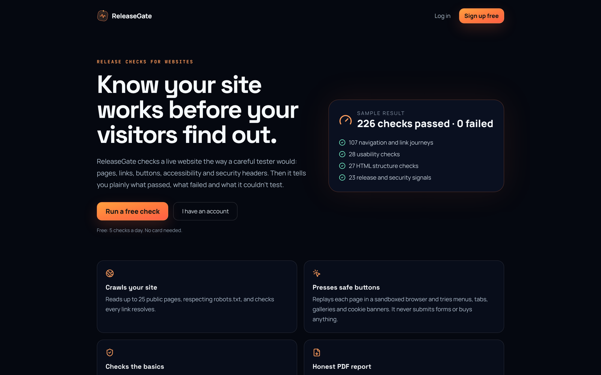
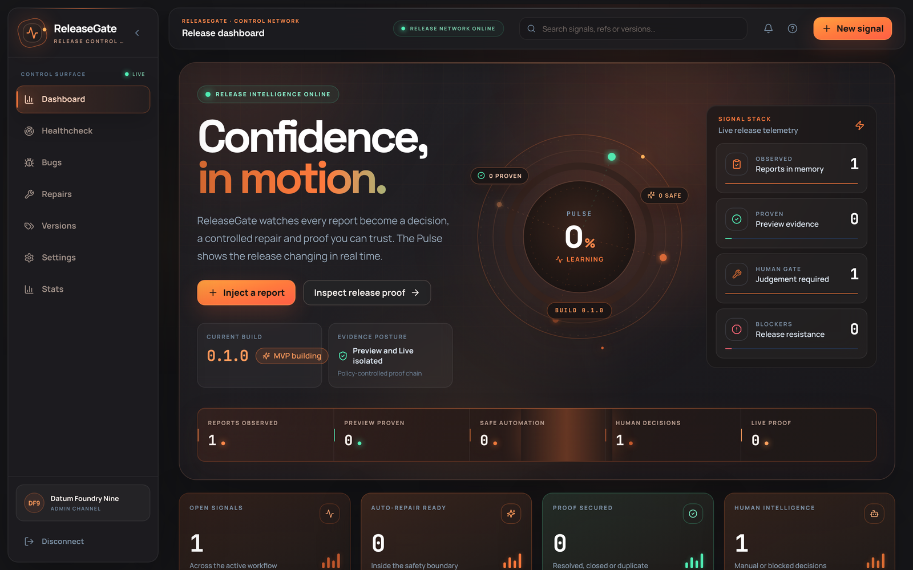
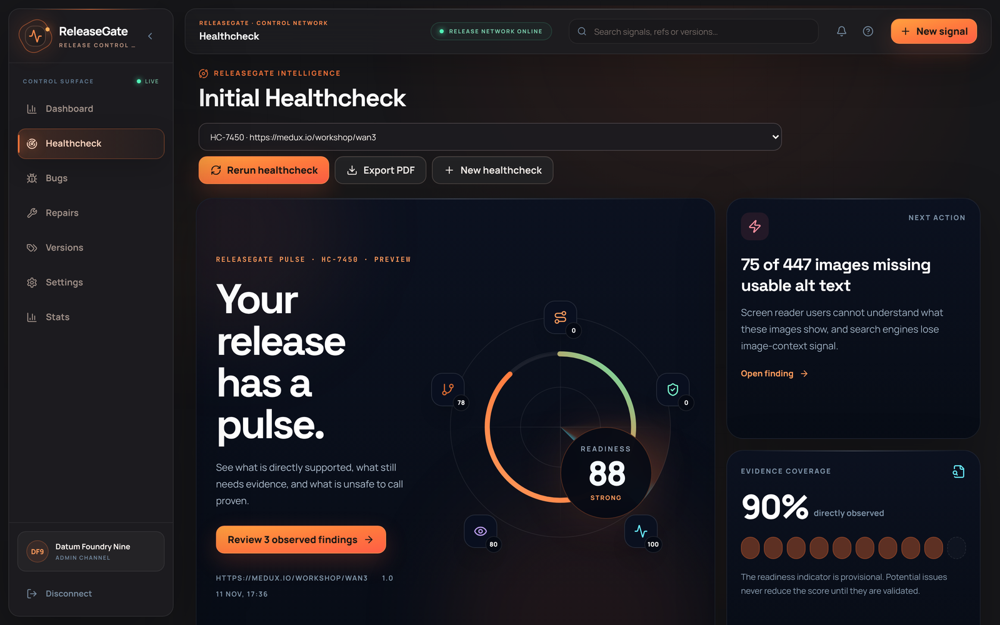
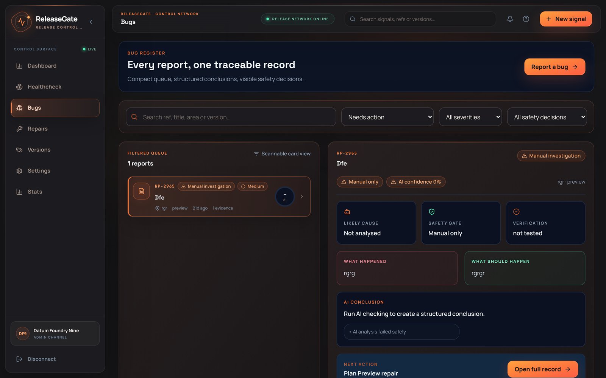

# ReleaseGate

**Know your site works before your visitors find out.**

ReleaseGate checks a live website the way a careful tester would: it reads the pages, follows the links, presses the safe buttons in a sandboxed browser, and looks at accessibility, HTML structure and security headers. Then it tells you plainly what passed, what failed, and what it **couldn't** test. Nothing is ever marked as passing unless it was actually observed.

Behind the checker sits a small release control room: bug reports come in, get analysed, get a repair proposal, and only reach a version after the evidence is in and a human has signed off where the policy says so.

**Live demo:** [releasegate.df9labs.com](https://releasegate.df9labs.com) (free account, 5 checks a day)



## Screenshots

| Release dashboard | Healthcheck result |
|---|---|
|  |  |



## What it does

- **Website healthchecks.** Crawls up to 25 public pages, respects `robots.txt`, checks every link, and replays each page in a signed-out, sandboxed Chromium to exercise menus, tabs, galleries and cookie banners. It never submits forms or buys anything.
- **Honest results.** Every finding is labelled as observed, failed or untested. Missing evidence never counts as a pass, and potential issues never lower the score until they are confirmed.
- **Button checks.** Discover the buttons on a page, then say what text you expect to appear after a click. ReleaseGate presses it and records what really happened.
- **PDF reports.** Export any saved healthcheck as a tagged A4 PDF with its evidence.
- **Release control loop.** Report → analysis → repair in preview → proof → human gate → version, with every decision bound to the evidence it was made on.
- **Optional AI analysis.** Plug in any OpenAI-compatible endpoint. The model can only *propose* a plan. Release authority stays with the local policy.
- **Windows app inspection** (local installs only). Inspect a running desktop app's buttons and record verified outcomes.

## Quick start

You need **Node.js 24.14 or later**.

**Windows**

```powershell
.\run.cmd
```

**macOS / Linux**

```sh
node scripts/start-local.mjs
```

The first launch installs the locked dependencies, builds the app, creates the SQLite database and seeds a small demo workspace. Open **http://127.0.0.1:4310** and sign in as `admin@releasegate.local`. A random password is generated for you on first run and saved as `DEMO_ADMIN_PASSWORD` in the private `.env` file in the project folder.

For development, run `npm run dev` (client, with hot reload) alongside `npm run dev:api` (server).

## Configuration

Copy `.env.example` to `.env` and adjust. All settings are optional for a local demo.

| Setting | What it does |
|---|---|
| `HOST`, `PORT`, `DATA_DIR` | Where the server listens and where the SQLite database lives. Defaults: `127.0.0.1`, `4310`, `./data`. |
| `DEMO_ADMIN_EMAIL`, `DEMO_ADMIN_PASSWORD` | The first administrator account. |
| `PUBLIC_ORIGIN` | Your public HTTPS origin when running behind a reverse proxy. |
| `LLM_API_KEY`, `LLM_ENDPOINT`, `LLM_MODEL` | Optional proposal-only AI analyser (OpenAI-compatible). |
| `DF9_INTAKE_KEYS` | Keys that let other apps `POST /api/reports` into ReleaseGate. |

Every limit (page counts, timeouts, daily allowances) and the file where you change it is listed in the [reference guide](docs/REFERENCE.md#limits-and-where-to-change-them) and in [RUNTIME-LIMITS.md](RUNTIME-LIMITS.md).

## Deploying

- **Single server with Docker:** see [Docker on Ubuntu](docs/REFERENCE.md#docker-on-ubuntu).
- **Static front end on Netlify + API on Ubuntu:** see [deploy/ubuntu/README.md](deploy/ubuntu/README.md). The setup script generates a strong admin password and keeps it on the server.

## Tech stack

React 18, TypeScript, Vite and Tailwind on the front end. Fastify on Node 24 with the built-in SQLite driver and Drizzle on the back end. Playwright Chromium for browser checks. Fonts and icons are served locally; no third-party calls at runtime.

```
src/        React app (views, components, API client)
server/     Fastify API, healthcheck engine, repair workflow, migrations, seed data
tests/      Node test runner suites, Playwright end-to-end specs, Windows inspector test
scripts/    Local launcher, release audit, Netlify packaging, demo helpers
deploy/     Netlify and Ubuntu (Docker Compose + Caddy) deployment files
docs/       Reference guide and screenshots
```

## Testing

```sh
npm run typecheck
npm test            # unit and API tests
npm run test:e2e    # browser journeys (needs Playwright Chromium)
```

Browser-based tests need a Chromium that Playwright can launch with its sandbox. Where it can't start, ReleaseGate reports those checks as **untested** rather than passing them, and the same is true of the test suite.

## Security

ReleaseGate only reads public addresses. It refuses loopback, private, link-local, carrier-grade NAT and Tailscale ranges, checks every DNS answer and redirect, and pins each connection. Passwords use salted scrypt; sessions use HTTP-only, SameSite=Strict cookies.

Found a security problem? Please email **hello@datumfoundrynine.co.uk** rather than opening a public issue.

## Licence

MIT. See [LICENSE](LICENSE). Bundled fonts and icons keep their own licences in [public/fonts/licences](public/fonts/licences).

---

Built by [Datum Foundry Nine](https://datumfoundrynine.co.uk).
